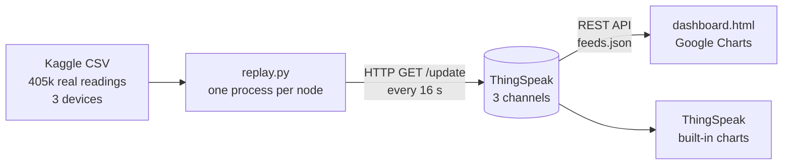

# IoT Sensor Data Simulation Dashboard

A cloud IoT pipeline that replays **real environmental sensor telemetry** from three Raspberry Pi devices as if they were live, streams it to the **ThingSpeak** cloud, and visualizes it on a **custom real-time dashboard** with multi-node switching and threshold alerts.

No physical hardware needed: the "devices" are Python scripts that replay a public Kaggle dataset row by row, the way IoT teams test pipelines before deploying sensors.


---

## Architecture



| Layer | What it does |
|---|---|
| **Data source** | [Environmental Sensor Telemetry Data](https://www.kaggle.com/datasets/garystafford/environmental-sensor-data-132k) (Kaggle): temperature, humidity, CO, smoke, LPG, light and motion from 3 devices, July 2020 |
| **Simulated devices** | `replay.py` filters one device's rows, sorts them by time, and sends each reading to its own ThingSpeak channel, looping forever |
| **Cloud** | ThingSpeak, one channel per node, 7 fields each, public read access |
| **Dashboard** | `dashboard.html` polls the ThingSpeak read API every 15 s and renders cards, charts, alerts and a live/stale/offline status indicator |

## Sensor nodes

| Node | Device MAC | Environment | Typical readings |
|---|---|---|---|
| Node 1 | `b8:27:eb:bf:9d:51` | Stable, warm | ~22.7 °C, ~51 % RH |
| Node 2 | `1c:bf:ce:15:ec:4d` | Variable temp/humidity | ~27 °C, ~78 % RH |
| Node 3 | `00:0f:00:70:91:0a` | Stable, cooler | ~19.7 °C, ~76 % RH |

## Features

- **Real data, not random numbers:** every reading comes from an actual sensor log
- **Multi-node dashboard:** switch between 3 sensor nodes; linkable views (`#node2`)
- **Live status indicator:** green *Live*, yellow *stale* (no data for 60 s), red *offline*
- **Two-layer alerting:**
  - *Fixed limits* (red): the same safety limit for every node, e.g. smoke > 0.028
  - *Per-node anomaly detection* (amber): each reading is compared to that node's own recent baseline using a z-score; values ≥ 3 standard deviations from normal are flagged, with a minimum spread so normal sensor jitter isn't flagged
- **Fleet view:** status cards for all nodes at once (live / stale / offline, latest readings, alert badge)
- **Event log:** timeline of limit breaches, anomalies, and nodes going offline or coming back
- **Test injection (`spike.py`):** sends one labelled *TEST SPIKE* reading to show the alerting works
- **Rate-limit aware:** respects ThingSpeak's 15-second free-tier limit and retries rejected sends without skipping data
- **Fast-forward replay:** `STEP` setting skips rows so ~1 minute of original data is sent per update
- **Secrets kept out of code:** write keys load from a git-ignored `.env` file

## Field mapping

| ThingSpeak field | Sensor | Notes |
|---|---|---|
| field1 | temp | °C |
| field2 | humidity | % RH |
| field3 | co | gas concentration |
| field4 | smoke | gas concentration |
| field5 | lpg | gas concentration |
| field6 | light | True/False → 1/0 |
| field7 | motion | True/False → 1/0 |

## Setup

### 1. Clone and install

```bash
git clone https://github.com/<your-username>/iot-sensor-dashboard.git
cd iot-sensor-dashboard
python3 -m venv venv
source venv/bin/activate
pip install -r requirements.txt
```

### 2. Get the dataset

Download `iot_telemetry_data.csv` from the [Kaggle dataset page](https://www.kaggle.com/datasets/garystafford/environmental-sensor-data-132k) and place it in the project folder.

### 3. Create ThingSpeak channels

For each node, create a channel at [thingspeak.mathworks.com](https://thingspeak.mathworks.com) with fields 1–7 named as in the table above, and enable **Sharing → Share channel view with everyone**.

### 4. Add your write keys

Create a `.env` file in the project folder:

```
TS_WRITE_KEY=your_node1_write_key
TS_WRITE_KEY_2=your_node2_write_key
TS_WRITE_KEY_3=your_node3_write_key
```

### 5. Set your channel IDs

In `dashboard.html`, set the `id` of each entry in the `NODES` list to your channel IDs.

### 6. Run

One terminal tab per process:

```bash
python replay.py 1          # Node 1
python replay.py 2          # Node 2
python replay.py 3          # Node 3
python3 -m http.server 8000 # dashboard server
```

Open **http://localhost:8000/dashboard.html**.

> Serve the dashboard over HTTP rather than opening it as a `file://` URL. Chrome treats `file:` URLs as unique security origins, which causes cross-frame warnings.

## Demo: anomaly vs. fixed limit

With all nodes running, inject a small gas spike into Node 2:

```bash
python spike.py 2        # gas readings x1.25: under the fixed limits, but unusual for this node
python spike.py 2 3      # gas readings x3: a big leak that trips both layers
```

The first command shows why per-node anomaly detection matters: the fixed thresholds see nothing wrong, but the reading is far outside Node 2's normal range, so it's flagged amber. Injected readings carry the ThingSpeak status `TEST SPIKE` and are labelled `[test injection]` on the dashboard.

## Project structure

```
├── replay.py          # simulated IoT device: replays one node's data to ThingSpeak
├── dashboard.html     # custom real-time dashboard (Google Charts)
├── spike.py           # injects one labelled test spike to demo the alerting
├── requirements.txt   # Python dependencies
├── screenshots/       # images used in this README
├── .env               # your API keys (git-ignored, not committed)
└── iot_telemetry_data.csv  # dataset (git-ignored, download from Kaggle)
```

## Security notes

- **Write keys never appear in code.** They load from `.env`, which is listed in `.gitignore`.
- **The dashboard only uses the public read API**, so no keys are exposed in the browser.
- Channels are public read-only. Nobody can push data without the write key, and any leaked key can be regenerated on the channel's API Keys tab.

## Possible extensions

- **Smarter baselines:** time-of-day aware baselines or an ML model (e.g. Isolation Forest) instead of a rolling z-score
- **Google Sheets logging:** mirror readings to a sheet for long-term storage
- **Notifications:** ThingSpeak React + ThingHTTP to send an alert when a threshold is crossed

## Tech stack

Python (pandas, requests) · ThingSpeak REST API · HTML/CSS/JavaScript · Google Charts
